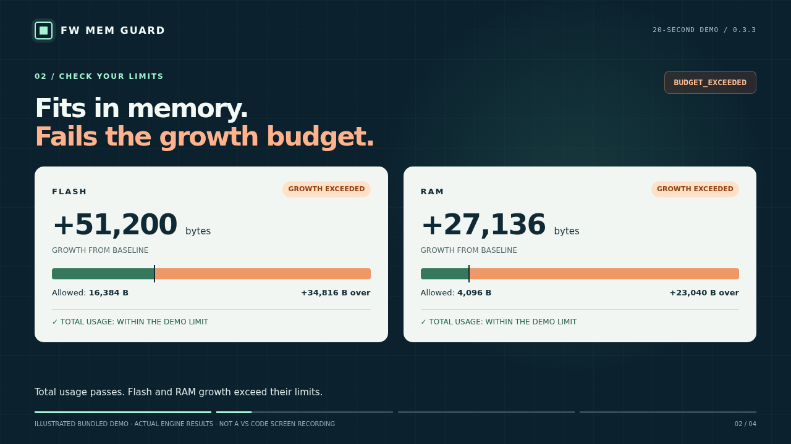

# FW Mem Guard — public documentation

## Verified firmware examples

| Firmware | Exact configuration | Independently checked growth |
|---|---|---|
| MicroPython v1.24.1 | `NUCLEO_F411RE`, STM32F411RE / Arm Cortex-M4; GNU Arm; source `ecfdd5d6f9be971852003c2049600dc7b3e2a838` | Flash +8,240 B; RAM +4,096 B |
| Zephyr v3.7.0 | `qemu_cortex_m3`, Arm Cortex-M3; `gnuarmemb`; source `36940db938a8f4a1e919496793ed439850a221c2` | Flash +0 B; RAM +256 B, attributed to `app/libapp.a(main.c.obj)` |

These are allocated-memory checks on exact paired builds, not hardware execution or blanket certification of all boards, IDEs, Zephyr configurations or nRF Connect SDK. [Evidence and file selection](https://itainover-create.github.io/fw-mem-guard/REAL_FIRMWARE.html#zephyr).

**VS Code extension:** Windows x64; macOS 15+ on Apple Silicon or Intel. **Linux x64:** separate CLI / CI package targeting glibc 2.28+, tested on Rocky Linux 8 and Ubuntu 24.04 with Node.js 22 and 24; no Linux VSIX. The compiled CLI is available from the public v0.3.7 release.

**Your build grew. Know by how much.** Compare firmware Flash/RAM and check your chosen budgets locally in VS Code.

**[Download the 29-second demo video](https://raw.githubusercontent.com/itainover-create/fw-mem-guard/main/media/fw-mem-guard-demo.mp4)**, then open it in your video player. The guides below can be read directly on GitHub without downloading HTML files.

This repository contains public documentation and illustrated demo media only. The extension implementation is maintained separately.

- [Open the public website and watch the demo](https://itainover-create.github.io/fw-mem-guard/)
- [Install the pre-release](https://marketplace.visualstudio.com/items?itemName=fwmemguard.fw-mem-guard)
- [English quick start](START_HERE_EN.md)

- [Support](SUPPORT.md) · [Privacy](PRIVACY.md)
- [29-second illustrated demo](media/fw-mem-guard-demo.mp4) · [Transcript](media/demo-transcript.html)
- [Demo result](media/demo-result.json) · [Result and media provenance](media/demo-evidence.json)

Version 0.3.7 is published as a pre-release in Marketplace and Open VSX for Windows x64, Mac Apple Silicon and Mac Intel; public downloads were verified against the approved packages. Native build/package checks passed; this is separate from installed GUI acceptance. Inside VS Code, run **FW Mem Guard: Open User Guide** for version-matched offline help.

The video illustrates actual results from the bundled engine and reduced-report exporter; it is not a VS Code screen recording or an installation acceptance test. Its capture timestamp is fixed for repeatable presentation. All firmware data in it is the bundled example, not customer firmware.

Support: `fwmemguard.support@gmail.com`. Public issues are visible to everyone: review diagnostic text and remove sensitive details before posting. Do not attach source, Map/ELF, credentials or customer artifacts.

The Pages workflow stages only the explicit documentation/media allowlist. There are no analytics, embedded third-party players or upload forms. GitHub hosting policies apply.

[Verified MicroPython example and guided setup](REAL_FIRMWARE.html) · [Download the F411 build pair](samples/micropython-f411-v1.24.1.zip). Independent GNU objdump reference output and third-party notices are included.

## First comparison and compatibility

[Follow the single trial path](https://itainover-create.github.io/fw-mem-guard/TRY_IT.html): install inside VS Code, run the demo and verified MicroPython example, compare your builds, save a project, then compare after a real rebuild. Host OS and firmware target requirements are documented separately there.

## GitHub Action

The Action is published in [itainover-create/fw-mem-guard-action](https://github.com/itainover-create/fw-mem-guard-action). Its pinned release verifies the compiled CLI archive before extraction. This documentation/download repository is not an Action; do not use it in a workflow's `uses:` field. See the [CLI JSON contract](CLI_JSON.md).
